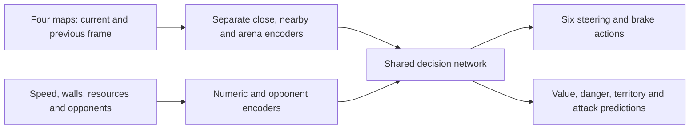

# Blacklight architecture review

## Decision before the long training run, 19 October 2026

The network is sound and nothing in it blocks learning. The one defect that did
block learning was in the teacher, not the network: the search's completed Q
values were never rescaled, so the training target stayed within a KL of about
0.004 of the policy for the whole run and self-play taught it almost nothing.
That is fixed in `sim/selfplay.cpp` (see [V4.md](V4.md#training)); from the same
checkpoint and seed, 100 updates measured a gain of 0.038 before and 0.138 after.

The network was reviewed branch by branch with these conclusions. They are the
basis for training the current architecture as it is rather than changing it
first.

- **Cost.** A decision costs about 1.5 GFLOP per player; 68% of that is the arena
  tower, 16% each local tower. Self-play speed, not capacity, is the project's
  limit (8.2 M parameters have seen 1.27 M decisions). Shrinking the arena tower
  would mean new weights or distillation, so it waits for a measured comparison.
- **Previous frame.** The second frame of each map is the last decision's
  observation, drawn in the heading of that time. Right after a turn it is rotated
  90° against the current frame and the frame difference carries no motion for
  that one decision. The time-since-turn scalar marks exactly those decisions, so
  the network can learn to discount the stale frame; a re-rendering fix would
  change the observation contract in the simulator, the engine, playback and the
  recordings at once, and is not worth that risk before the run.
- **Territory distance bits.** The BFS distance enters as six bit-planes. The stem
  convolution is linear in its inputs, so one filter with weights 1, 2, 4, 8, 16,
  32 recovers the distance exactly; no change is needed.
- **Opponent attention.** The three enemy tokens are pooled with learned softmax
  weights. A flat query gives a plain average of all enemies, so attending to one
  enemy is a choice the network can make, not a limit of the architecture; the
  maps show every enemy regardless.
- **Arena conditioning.** The arena summary may scale the local features by at
  most ±10%. The learned conditioning weights are small (row norms ≤ 0.41), so the
  cap is unlikely to bind; it also reaches the trunk directly. Left alone.
- **Memory.** The 256-unit GRU's output projection is exactly zero in the current
  checkpoint, so it changes nothing yet; its cost is live (the search evaluates
  every tick of a macro edge, and a batch is 16 stretches of 32 consecutive
  decisions rather than 512 scattered ones). Its only evidence is one seed and six
  games. It is kept because removing it is a migration across the network, native
  inference, search and playback, and training will now teach it; whether it
  helps is a question for a later paired comparison.

All legal moves are root candidates in every search, so braking, which imitation
drove to a probability near zero, is revisited wherever the look-ahead finds it
best; its bonus ((50 + max visits) × 0.1, at most 7.4 with 24 simulations) is of
the same order as the logit deficit, so recovery is expected to be gradual.

## Integrated memory upgrade, 19 October 2026

The 256-unit memory integration has been completed across the network, native
inference, per-life gameplay state, sequence RL/search, imitation and inspection.
Its action/time-aware GRU receives 775 inputs and brings the model to 8,155,373
parameters. Initial migration retains the learned tensors and predictions; the
new residual starts at zero and needs subsequent training. CPU/MPS learning and
save/resume checks exercise the full network, not just a frozen-feature adapter.

The sections below retain the earlier input upgrade and prototype evidence.
Statements there about keeping memory outside production describe the historical
prototype decision, superseded by the explicit integration. They do not establish
a fighting-strength improvement for the newly migrated production network.

## Installed input upgrade

Blacklight now receives each nearby opponent's braking reserve, used rubber, and separate left/right turn waits. The original 96 scalar positions retain their meanings; 12 fields are appended. The shared opponent encoder grows from eight to twelve inputs, adding only 256 weights. The deployed network has 7,164,653 parameters and observation version 2.

The one checkpoint, `runs/blacklight/latest.pt`, remains at update 11,280 with 3,766 cumulative imitation updates. Existing weights, counters and optimizer moments were preserved; the new connections and their optimizer moments started at zero. All 160 checked decisions matched the original model immediately after migration. A disposable MPS training check confirmed that the new columns learn and that their learned values and optimizer state survive save/resume. That check did not modify the deployed weights.

The full suite passed 436 tests. Native/Python comparisons exercise learned, nonzero added connections in float32 and float16; engine/simulator tests check the observation mapping. The staged dedicated engine and native policy export were updated, and the viewer loads the migrated Blacklight checkpoint. The separately installed game app was not rebuilt.

Evidence: [migration](../runs/blacklight/audit/input-migration.json), [decision equivalence](../runs/blacklight/audit/input-migration-validation.json), [MPS learning and resume](../runs/blacklight/audit/new-input-learning-smoke.json). The [current architecture specification](V4.md) describes the new contract.

## Memory experiment

The prototype adds a 256-unit GRU and a residual projection into the existing decision features: 985,344 additional parameters, or 13.75% of the current network. Its combined parameter count would be 8,149,997, with 1 KiB of float32 recurrent state per active player. The residual starts at zero, preserving the original policy before adapter training. A stateless residual with 984,448 parameters controls for simply adding more capacity.

Both adapters received the same 360 updates and 22,564 learned decisions from 51 training lives. Training windows use up to 16 burn-in decisions (0.8 seconds) followed by 32 learned decisions (1.6 seconds). Validation carries state throughout each of 13 held-out lives and resets between lives; 2.4 seconds is the maximum training-window span, not a hard memory-expiry limit.

| Held-out behavior | Base | Matched stateless adapter | GRU | GRU reset every decision |
| --- | ---: | ---: | ---: | ---: |
| Exact teacher turn and direction reproduced, out of 321 | 162 | 161 | 156 | 158 |
| Turns where the teacher went straight, out of 8,216 | 193 | 189 | 153 | 176 |

History reduces the second count, but does not improve exact teacher-turn recall. These are agreement measures, not proof that a different move is wrong in combat. The repeated training run reproduced all recorded validation metrics and confusion matrices exactly. The original run did not retain prediction hashes, so that comparison does not establish byte-identical per-observation predictions.

The base features and policy head stayed frozen, including the newly added zero resource-input columns. This experiment isolates history of existing features; it does not test learning the new opponent inputs. The demonstrations contain no braking actions. Candidate adapters remained in memory and never replaced or created a persistent fighter checkpoint.

Implementation: `arma_ai/memory_experiment.py`; the focused 12-test suite checks initial parity on CPU/MPS, state resets, whole-life split isolation, burn-in gradients, contiguous windows and timing accounting. Detailed evidence is in [memory-comparison.json](../runs/blacklight/audit/memory-comparison.json).

### Completed fighting comparison

Each policy completed the same six simulator situations: three arena sizes, with two spawn rotations each, against the depth-2 Hunter. Controls were greedy with no search. These are six deterministic cases, not an estimate of general win rate. The earlier 24-round run repeated the same configurations and hit its GRU time budget; its partial results are retained separately. The completed comparison is `paired_six_case_rerun` in the report.

| Situation, same result for both rotations | Base | Matched stateless adapter | GRU |
| --- | --- | --- | --- |
| Small arena, size −3 | Dies at 39.20 s | Dies at 27.00 s | Credited kill while surviving at 27.05 s |
| Medium arena, size −1.5 | Both alive at 60 s limit | Both alive at 60 s limit | Both alive at 60 s limit |
| Large arena, size 0 | Hunter dies at 39.95 s; no credited kill | Hunter dies at 39.95 s; no credited kill | Both alive at 60 s limit |

Memory produced a useful close-combat change, but the larger fights ended in stalemates. No variant braked, produced non-finite outputs, or rapidly alternated opposite turns in these cases. The GRU's hidden state stayed finite throughout complete lives.

In this rerun, synchronized MPS inference averaged 2.495 ms per issued decision for the base and 3.385 ms for the GRU. These are amortized costs over batches of up to six games, whose sizes shrink differently as fights finish; the roughly 1.36× ratio is not a controlled singleton or native-engine latency measurement. The earlier, separate run with up to twelve games had a 2.64× ratio. Timing depends on this workload and must be checked in any actual integration.

Decision: keep the 256-unit memory implementation as an experiment. It has a promising tactical result, but this short, single-seed trial does not establish a broad fighting improvement. The deployed Blacklight keeps its existing two-frame architecture with the installed opponent inputs; its weights and optimizer continuity are preserved. Braking coverage, corrective examples after the student's mistakes, and the exploiter feedback path remain separate training work.

## Original audit, before the input upgrade

The remaining sections record the original observations and recommendations. Parameter counts and missing-input findings below describe the pre-migration checkpoint; the installed changes above supersede them.

Recommendation: improve Blacklight's observation inputs first while preserving its current core network and learned weights. Do not replace the entire network or assume that adding more parameters will fix the recent results. Longer memory is a second, testable candidate. Training quality also needs attention independently of the architecture.

## What the words mean

- **Architecture:** the structure that turns game observations into decisions.
- **Weights:** the numbers that structure has learned through training.
- **Checkpoint:** the saved weights and training state, currently `runs/blacklight/latest.pt`.

## What Blacklight currently does

It makes a decision every 0.05 seconds. Its 7,164,397-parameter network receives four 64-by-64 maps: close surroundings, nearby surroundings, the whole arena, and an estimate of territory. It receives current and previous maps, plus exact numerical sensors and information about three nearby opponents.

The arena encoder adjusts how local features are interpreted. An opponent-attention branch weighs relevant opponents. Attention here works over spatial cells and opponents; it is not persistent memory or a simulation of future moves. The explicit temporal input spans only 50 milliseconds. Existing trails visible in the current maps can still carry information about earlier play.

The controls already include straight, left, right, brake, left-plus-brake and right-plus-brake. Adding braking capability to the architecture is unnecessary: it already exists.

Implementation: `arma_ai/model.py`, principally `PolicyNet`, `tower_input`, `attend_opponents` and `trunk_and_arena`. Exact observations are built in `src/tron/gNeural.cpp`; playback is in `arma_ai/play.py`. Training search lives separately in `ai/sim/selfplay.cpp`.

## Measured evidence

A new real-engine comparison used 20 completed greedy duels per model, maximum-IQ built-in opponents, size -3 arenas, 600-metre trails, and no search. The old model was read from its existing Trash archive only for diagnosis; it was not restored as another active checkpoint. Both model instances and engine work directories were temporary.

| Saved state | Wins | Draws | Losses | Win rate | Credited kills |
| --- | ---: | ---: | ---: | ---: | ---: |
| Before imitation, update 7,514 | 17 | 0 | 3 | 85% | 15 |
| Current Blacklight, update 11,280 | 13 | 0 | 7 | 65% | 13 |

This is a same-protocol comparison, not paired random seeds: native engine randomness was not explicitly seeded. Twenty games per model is a small sample. These measurements support investigating the training change, but do not establish a precise long-run difference. Both states use the same architecture.

Exact results are in `runs/blacklight/audit/controlled-comparison.json`.

## Confirmed architectural limits

**Missing opponent state.** Enemy inputs include relative position, heading, speed, current brake status and presence. They omit braking reserve, rubber and turn timing. A simulator probe constructed two states differing only in an enemy's braking reserve. All four maps, all 96 numerical inputs and the legal-action mask were identical, but identical subsequent controls produced enemy speeds of 14.6311 versus 19.9838 after 0.5 seconds. The network cannot distinguish those states from its inputs. This demonstrates a blind spot; it does not prove that the blind spot caused the current losses, that both constructed histories are reachable, or that their optimal actions differ. The [probe source and provenance](audit/blacklight-input-aliasing/README.md) are retained for inspection.

**Very short explicit history.** There is no recurrent state, previous action vector or previous numerical-sensor vector. Tracking opponent cooldowns, intent and a sustained attack could benefit from longer history. That benefit has not yet been measured for Blacklight.

**No deployment search.** The viewer and ordinary game policy choose directly from the network. The search used during RL training is not automatically running during these matches. Missed tactical consequences should not automatically be blamed on neural-network size.

**Finite geometry precision.** The close map uses binary one-metre cells. Sixteen exact ray distances partially compensate, and the local towers already process higher-resolution features before reducing them. Submetre-gap tests are needed before claiming that larger maps are the bottleneck.

## Training issues that architecture alone will not fix

- The demonstration bots never brake. There are no brake or combined brake-turn examples, even though Blacklight can execute those controls.
- The student learns from states reached by the teacher. It is not yet being corrected in the states reached after its own mistakes. This is the distribution-shift problem addressed by [DAgger](https://proceedings.mlr.press/v15/ross11a.html).
- At the latest completed validation, update 11,234, it reproduced 64 of 100 teacher turns and made 77 turns on 1,869 examples where the teacher went straight. Overall agreement therefore conceals meaningful timing and action errors.
- Turn examples receive substantially larger loss weights than straight examples. That can improve turn recall while shifting greedy action choices; it should be assessed through actual games.
- Imitation changes shared visual and decision features while leaving value and auxiliary output-head weights frozen. Frozen head weights do not guarantee unchanged predictions. A 96-position, action-balanced probe against the archived pre-imitation model found mean absolute value-output change of 0.387, with 11 sign changes. That measures drift, not calibration error, but it warrants checking the critic before using it for search again.
- On that same diagnostic probe, mean braking probability fell from 50.4% to 0.0258%; greedy braking choices fell from 58/96 to zero. This is a probe on teacher states, not a gameplay action-frequency measurement.

Two further continuity details matter. The imitation reference is refreshed from the current policy at each cycle, so its KL penalty limits local movement rather than preserving the original RL behavior indefinitely. Every cycle saves before held-out validation; validation currently reports regressions rather than controlling whether updates are accepted. Within-cycle weighted validation loss increased in 9 of 28 logged cycles. Different fresh datasets also mean that scores from separate cycles are not a fixed regression benchmark. None of these behaviors requires a larger network to change.

## Proposed order of improvement

1. Keep the existing spatial encoders, global context, opponent attention and six-control policy. Extend the opponent inputs with mechanically relevant resource and timing information, accompanied by focused braking/cutoff scenarios.
2. Repair the imitation setup: include recovery situations reached by the student, use a teacher or additional objective that covers braking, and measure whether turn weighting improves actual games. Do not interpret agreement with demonstrations as fighting strength.
3. Test longer temporal context or a small recurrent component only after establishing a reproducible tactical benchmark. [Recurrent-network research](https://arxiv.org/abs/1507.06527) supports memory as a way to address partial observations; it does not guarantee a gain in this game.
4. Test bounded inference planning separately from changes to network capacity, using a validated value model.

## Preserving the checkpoint

An upgrade must not silently start a new random model. Unchanged layers retain their learned tensors. Added feature connections can be initialized to zero, so the expanded model initially behaves like the existing one; the precise input mapping and numerical equivalence must be tested in both Python and the native implementation. A recurrent extension could use an initially inactive residual path, but requires sequence-training and inference-state changes as well.

For incompatible shapes, an explicit migration or distillation process is required. Test the converted model in a temporary workspace before atomically replacing the one canonical checkpoint. Optimizer state needs a corresponding migration for changed parameters; it must not be blindly loaded into different tensor shapes. A structural change should have an explicit schema/version marker so old observations cannot silently be interpreted as the new layout.

This audit changed neither the architecture nor the production checkpoint. It establishes what should change next and which claims still need experiments.
