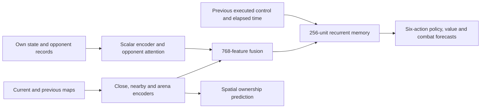

# Blacklight target architecture

Decision date: 19 October 2026, Australia/Melbourne.

This design has been implemented across gameplay, native inference, search,
sequence RL, imitation, recording and inspection. Mechanical and learning
verification is recorded in `runs/blacklight/audit/memory-integration.json`.
The canonical migration preserves update 11,280 and all existing learned tensors.
Newly added memory starts with a zero residual and learns during subsequent training.

This establishes a working recurrent architecture, not an experimentally proven
best fighter. This design is now selected and frozen: see
[the architecture decision](BLACKLIGHT-ARCHITECTURE-FREEZE.md). Qualify training
and fighting progress without repeatedly replacing the network. Structural
comparisons are reserved for a demonstrated representation or memory limitation.

## Selected network

Use the existing V4 spatial and opponent encoders, followed by one persistent,
action-aware, 256-unit residual GRU. Keep six joint steering/braking actions.

| Component | Concrete specification | Purpose |
|---|---|---|
| Observations | Four 64×64 maps, current and previous frame; 108 current scalars | Preserve precise sensors and the installed opponent resource/cooldown inputs |
| Local encoders | Separate existing progressive towers for 1 m close and 2 m nearby maps; 192 features each | Read nearby wall and gap geometry at its appropriate scale |
| Arena encoder | Existing 128-channel residual tower, two spatial attention layers and 256-feature summary | Represent space, routes and territory; condition both local towers |
| Numeric branches | Existing 256-feature own/arena encoder and 64-feature masked opponent-attention output | Represent exact measurements and every enemy in the supported four-player arenas |
| Fusion | Existing 960→768→768 layers | Preserve the learned common representation |
| Memory | GRU with 775 input features and 256 hidden units; project 256→768 and add to the original fused features | Retain a running summary of the fight and the actions taken |
| Outputs | Six policy logits, bounded outcome value and territory/danger/surviving-kill forecasts; ownership remains on arena features | Learn decisions and their consequences from consistent evidence |

The seven added memory inputs are the previous **executed** six-action one-hot
control and elapsed game time scaled by the normal 50 ms interval. A new life has
zero action history and zero elapsed time. An asynchronously rejected command is
not an executed action. Both inputs are implemented in the simulator, socket
controller, recorder and native game.

The complete network has **8,155,373 parameters**, adding 990,720 to
the previous 7,164,653. Recurrent state uses **1 KiB per player** in float32. These
counts were checked from the current checkpoint and matching PyTorch layer shapes.
Zero-initialize the residual projection so migration initially preserves the old
policy and predictions. Preserve existing weights, counters and compatible
optimizer state through an explicit versioned migration and numerical checks.

256 units is the selected starting design, not a proven optimal width. Its added
parameter storage is modest on the verified M3 Max with 36 GiB unified memory;
full activation, replay and search memory still require measurement.

## State and learning contract

Memory belongs to an individual player life. Real observations advance it once;
duplicate deliveries do not. Resets and identity checks must cover respawn, reused
slots, reconnects and changes of weights. Training actors should use a consistent
weight generation within a life. Any skipped-observation policy must be explicit
and exercised during validation.

Search branches require private copies of both recurrent state and action/time
context. Consume intermediate observations at decision boundaries, including those
inside a two-decision macro step. A hypothetical branch must never change the
live player's state or a sibling branch's state.

Both imitation and RL must learn contiguous sequences with explicit resets.
Random independent-frame imitation is incompatible with the persistent-memory
contract. Burn-in reconstructs context before the learned unroll; compare its
reconstructed state and outputs against full-life history before choosing a
burn-in length. An unroll length is a gradient horizon, not a memory expiry time.

Policy, value and vector auxiliary heads receive the remembered features. During
policy-only learning, freezing output heads alone does not protect their
predictions when shared features change. Preserve their outputs where appropriate,
and refresh/validate value and combat forecasts against actual outcomes before
relying on them for search. This contract must be implemented before qualification.

## Why this design

Persistent memory directly addresses the current 50 ms explicit history. It can
track developing maneuvers without reprocessing an increasingly large stack of
old maps at every decision. Previous controls make its state update explicitly
aware of its own actions.

The existing local/global encoders already handle different spatial scales and
global context. There is no current fighting evidence that a wider visual backbone,
a temporal Transformer, or a graph over every trail is a better use of this
machine's training budget. Those remain alternatives if a specific failure demands
them. A recurrent policy is a design choice supported by prior RL work, not proof
of a Tron performance gain: see [R2D2](https://openreview.net/pdf?id=r1lyTjAqYX).

The existing GRU prototype improved two small-arena situations but turned
large-arena wins into time-limit draws. It used frozen visual features and a
policy-only adapter, so it does not establish the strength of this full network.
Its results are retained in `BLACKLIGHT-ARCHITECTURE-REVIEW.md` and
`runs/blacklight/audit/memory-comparison.json`.

## Qualification before a long run

First verify initial migration equivalence; Python/native parity through whole
sequences; reset and search-branch isolation; meaningful gradients; and resumed
sequence learning. Complete imitation, play and inspection integration as well as
RL. These checks establish correct implementation, not fighting strength.

Keep the selected architecture for the learning pilot and compare its learned
behavior with the unchanged checkpoint on held-out fights. Changes to opponents,
scenarios, data and learning settings do not require another network migration.

If a reproducible failure later implicates the recurrent architecture itself,
compare the existing V4, the proposed GRU network and a similarly sized
stateless residual control. Give the residual control the same action/time inputs
so that it controls for both added capacity and those inputs. Start from identical
existing V4 weights and zero residuals. Use the same data distribution, learned
decision budget and at least three training seeds; report wall-clock cost too.
About 100,000 learned decisions per seed is an initial screening budget, not an
assurance that the learning curves will be decisive. Extend only an inconclusive
comparison that still matters to the choice.

Evaluate held-out cuts, escapes, braking contests, narrow gaps and multiple
opponents across varied starts and three arena sizes. Measure wins, deaths,
surviving kills and stalled rounds together. Check whether resetting a trained
GRU's history removes its benefits. Confirm the leading candidate in the real
engine. Teacher agreement alone cannot select the fighter.

Profile the complete native path: main-thread observation construction, worker
inference, result application, actual decision cadence and rendered frame times.
The requirements remain 20 decisions per second and the requested 120 FPS game
presentation. A 50 ms decision interval and an 8.33 ms rendering interval are
different budgets. Test one and four neural players, plus complete training
throughput and peak memory. Existing socket timings do not certify this path.

The architecture is selected; the remaining checks qualify the training recipe
and fighting results for a long run. Reopen the structure only after a demonstrated
capability limitation. If an architecture comparison becomes necessary, inconclusive
results do not establish a winner. Temporary comparisons do not require multiple
permanent fighter checkpoints. Keep one canonical Blacklight.

The original design review did not train or deploy a model. The subsequent
implementation includes explicit checkpoint migration and native deployment,
with bounded learning checks in disposable directories. It does not start a long
training run or promote temporary learned test weights into the fighter.
