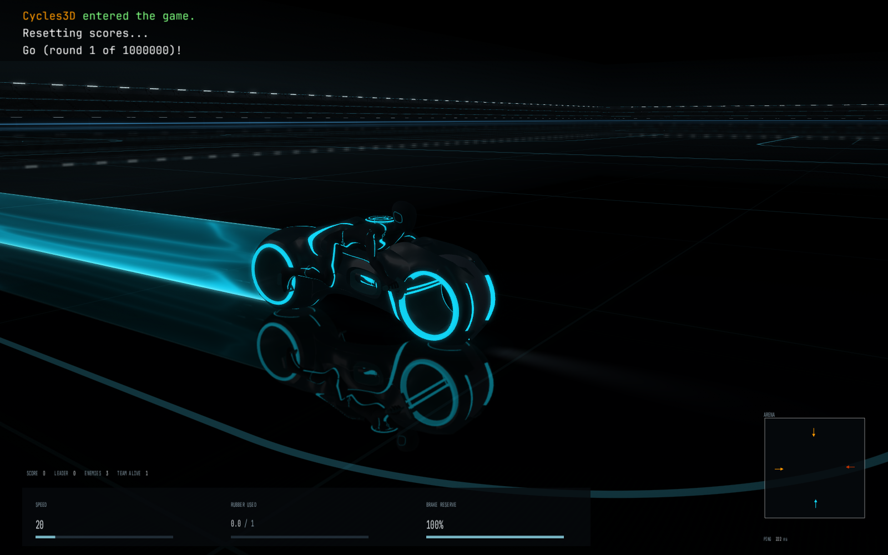
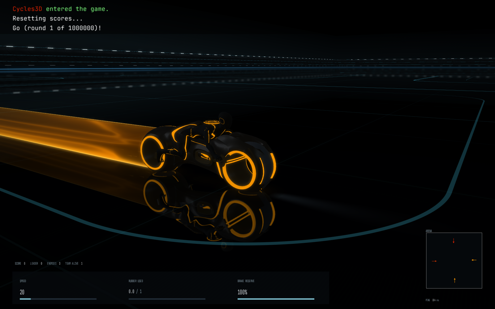

# Accepted graphics checkpoint — 24 October 2026

Romil accepted this version in local playtesting. It combines the supplied,
credited LiNk2.0 bike/rider with the dark arena and translucent flowing ribbons.
The editable Blender source, export utility, runtime assets and source licenses
are included in this repository.

[Recorded blue/amber preview](assets/current-ribbons.mp4)

The material follows the supplied image/description reference: a defined,
upright sheet with the visual softness of liquid and space visible behind it.
The external film was supplementary reference and is not bundled. Motion stays
in the surface lighting; turn geometry does not rise, flap or loop around the
rear wheel. The current connection also runs with saved `SIMPLE_TRAIL 1` profiles,
which bypassed the earlier fix.

The model uses 51,744 evaluated triangles, packed source textures and a repaired
2K scalar optical mask. Black body/suit surfaces remain non-emissive, the rear
shell clears the disc, and the raised fin is replaced by an optical stripe.
Original mesh control points, UVs and rig remain editable beneath modifiers.
See the [asset workflow](../../art/lightcycle-authored/README.md) and
[source credits](../../art/lightcycle-authored/CREDITS.md).

## Verification

Native and dedicated builds passed. Six focused local tests cover asset loading
and malformed input, bike/camera/impact motion, ribbon geometry and actual GLSL
rendering. The material check exercises 512 combinations of colour, projected
size, overlapping layers, animation time and mirror state; it checks transparent
coloured interiors and stable compositing while allowing pale edge cores.

Installed-game captures used a copy of the saved profile, including Simple Trails,
at close/wide views and at 3024 x 1964 with 4x MSAA and a 120 FPS cap. The latest
native turn run completed 46 accepted turns; measured ribbon columns remained
at constant height and on the floor with no folded edges. Test input and crash
protection were confined to isolated hidden clients. The normal controls,
snap-turn physics, black grid and quality settings were preserved.

[Checkpoint hashes and measurements](accepted-2026-10-24.json)

GitHub Actions runs the C++ motion and asset checks on Linux and macOS, validates
the utilities, and runs the existing AI CPU regressions. The native shader check
runs when the macOS host provides an accelerated OpenGL context; an unavailable
context is explicitly reported as skipped. It passed locally on the actual Mac.

The preview is a recording of isolated tests, not live control. Frames are native
RGB8 SDR, explicitly encoded as BT.709 and uniformly retimed to the recording
window without motion interpolation. It is not a frame-rate benchmark.
